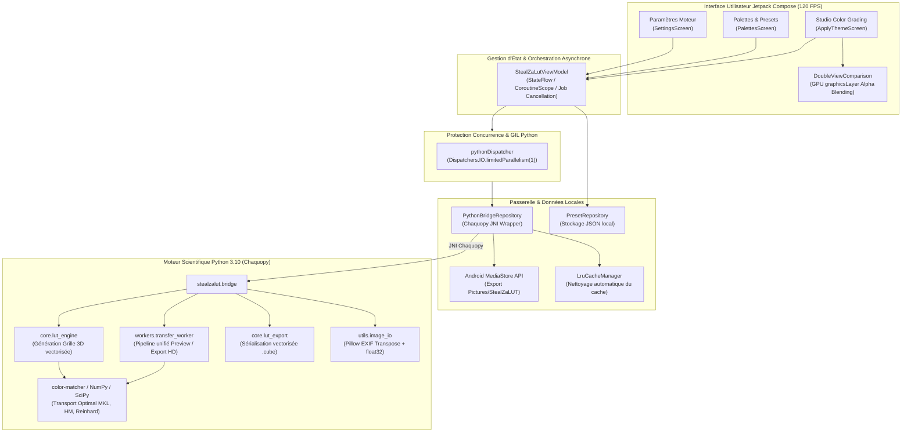

# StealZaLUT Mobile

[-3DDC84?logo=android&logoColor=white)](https://developer.android.com/)
[](https://kotlinlang.org/)
[-4285F4?logo=jetpackcompose&logoColor=white)](https://developer.android.com/jetpack/compose)
[](https://chaquo.com/chaquopy/)
[](https://scipy.org/)
[](LICENSE)

> **Application Android 100% hors-ligne de transfert colorimétrique haute fidélité et de génération de 3D LUT (`.cube`).**

---

## 1. Présentation du Projet

**StealZaLUT Mobile** est une application d'étalonnage photographique et cinématographique embarquée sur Android. Elle résout un problème récurrent pour les créateurs de contenu, photographes et coloristes mobiles : **capturer l'essence chromatique d'une œuvre de référence** (plan de film culte, tableau de maître, photographie professionnelle) pour l'appliquer instantanément à ses propres clichés ou l'exporter au format universel **Adobe 3D LUT (`.cube`)**.

L'ensemble des fichiers `.cube` générés est strictement conforme aux spécifications standard de l'industrie audiovisuelle, garantissant une compatibilité immédiate avec :
* **Logiciels de montage professionnels (Desktop)** : DaVinci Resolve, Adobe Premiere Pro, Final Cut Pro, Adobe Lightroom, Photoshop, Avid Media Composer.
* **Applications vidéo mobiles** : CapCut, VN Video Editor, Lumafusion, Alight Motion.
* **Moniteurs et caméras broadcast** : Atomos, SmallHD, Blackmagic Design, Sony FX series.

Le traitement s'exécute **intégralement en local sur l'appareil (100% Offline)**, sans aucun recours au cloud, sans création de compte, sans télémétrie et dans le respect absolu de la confidentialité des photos.

---

## 2. Fonctionnalités Clés

* **Traitement 100% Embarqué & Sécurisé :** Les algorithmes scientifiques tournent directement sur le SoC du téléphone via le runtime CPython embarqué Chaquopy.
* **4 Algorithmes Scientifiques de Transfert Chromatique :**
  1. `hm-mkl-hm` (*Histogram Matching + Monge-Kantorovitch Linear — Recommandé*) : Combine le transport optimal linéaire et l'alignement précis des distributions cumulées pour une dynamique et un contraste optimaux.
  2. `mkl` (*Monge-Kantorovitch Linear*) : Transport optimal de la matrice de covariance chromatique globale, respectant l'harmonie des teintes d'origine.
  3. `reinhard` (*Alignement statistique CIE LAB*) : Alignement des moments statistiques du premier et second ordre dans l'espace perceptuel uniforme CIELAB $L^*a^*b^*$.
  4. `hm` (*Histogram Matching*) : Correspondance cumulative canal par canal (R, G, B), procurant un transfert instantané et contrasté.
* **Aperçu Temps Réel à 120 FPS (Zéro Freeze) :**
  * Grâce à une architecture de composition matérielle GPU, le déplacement du curseur d'intensité ($\alpha \in [0\%, 100\%]$) est calculé nativement par le `RenderThread` Android via les shaders GPU de Jetpack Compose (`graphicsLayer { alpha = intensity }`).
  * **0 appel Python et 0 allocation Bitmap** lors des gestes de glissement.
* **Comparateur Avant / Après Haute Précision :**
  * Mode **Côte-à-côte** avec zoom tactile et déplacement panoramique synchronisés au pixel près.
  * Mode **Rideau interactif (Split-Wipe)** permettant de balayer l'image d'un doigt pour révéler les différences de colorimétrie.
* **Génération de 3D LUT Multi-Résolutions :**
  * $17 \times 17 \times 17$ ($4\,913$ nœuds) : Idéal pour les prévisualisations mobiles rapides et les applications légères.
  * $33 \times 33 \times 33$ ($35\,937$ nœuds) : **Standard Broadcast & Cinéma** (DaVinci Resolve / Premiere Pro).
  * $65 \times 65 \times 65$ ($274\,625$ nœuds) : Très haute précision pour préserver les dégradés subtils et éliminer tout risque de postérisation.
* **Extraction de Palettes & Gestionnaire de Presets :**
  * Extraction automatique des 6 couleurs dominantes avec affichage des codes hexadécimaux et copie rapide au presse-papier.
  * Bibliothèque locale de préréglages réutilisables en un clic dans le Studio.
* **Export Direct Galerie :** Sauvegarde des photos traitées directement dans l'album `Pictures/StealZaLUT` via l'API Android native `MediaStore`.

---

## 3. Architecture Technique

StealZaLUT Mobile s'appuie sur une architecture réactive moderne en couches (Clean Architecture + MVI/Unidirectional Data Flow), couplant la réactivité de Jetpack Compose à la puissance de calcul scientifique de l'écosystème Python.



### Arborescence Détaillée du Projet

```text
StealZaLut_Mobile/
├── app/
│   ├── build.gradle.kts                # Configuration AGP, Chaquopy, NDK arm64/x86_64, Dépendances
│   └── src/
│       ├── main/
│       │   ├── AndroidManifest.xml     # Déclarations activités, permissions MediaStore/Galerie
│       │   ├── java/com/stealzalut/mobile/
│       │   │   ├── MainActivity.kt                  # Point d'entrée, Compose Scaffold, Edge-to-Edge
│       │   │   ├── StealZaLutApplication.kt         # Préchauffage Chaquopy en arrière-plan & purge LRU
│       │   │   ├── core/
│       │   │   │   ├── AppConstants.kt              # Constantes d'interface, tailles de grille, formats
│       │   │   │   └── AppDimens.kt                 # Dimensions WCAG 2.1 AA, marges et rayons Compose
│       │   │   ├── data/
│       │   │   │   ├── bridge/
│       │   │   │   │   └── PythonBridgeRepository.kt # Wrapper Chaquopy thread-safe, limitedParallelism(1)
│       │   │   │   ├── cache/
│       │   │   │   │   └── LruCacheManager.kt       # Gestionnaire de cache disque (taille max & expiration)
│       │   │   │   ├── model/                       # Modèles immuables (@Immutable)
│       │   │   │   │   ├── AppSettings.kt           # Préférences utilisateur (LUT size, méthode par défaut)
│       │   │   │   │   ├── ColorimetryPreset.kt     # Préréglages sauvegardés (palettes, métadonnées)
│       │   │   │   │   ├── ColorTransferMethod.kt   # Enum des 4 algorithmes de transfert
│       │   │   │   │   ├── LutSize.kt               # Enum des dimensions 17³, 33³, 65³
│       │   │   │   │   └── ProcessResult.kt         # Types scellés de retours d'opération (Success / Error)
│       │   │   │   └── repository/
│       │   │   │       ├── PresetRepository.kt      # Sauvegarde et suppression des presets JSON locaux
│       │   │   │       └── SettingsRepository.kt    # Persistance des préférences utilisateur SharedPreferences
│       │   │   └── ui/
│       │   │       ├── components/                  # Composants UI modulaires
│       │   │       │   ├── DoubleViewComparison.kt  # Comparateur Avant/Après & Split-Wipe (120 FPS GPU)
│       │   │       │   ├── IntensitySlider.kt       # Curseur d'opacité fluide
│       │   │       │   ├── MethodSelector.kt        # Sélecteur visuel d'algorithme de transfert
│       │   │       │   ├── LutSizeSelector.kt       # Puces de sélection de dimension de LUT
│       │   │       │   ├── PaletteSwatchesView.kt   # Nuancier de couleurs avec copie Hex
│       │   │       │   ├── ImagePickerCard.kt       # Carte d'import photo avec ratios adaptés
│       │   │       │   └── SavePresetDialog.kt      # Dialogue de sauvegarde de preset
│       │   │       ├── navigation/
│       │   │       │   └── AppDestination.kt        # 3 Piliers de navigation : STUDIO, PALETTES, SETTINGS
│       │   │       ├── screens/
│       │   │       │   ├── MainColorGradingScreen.kt # Écran principal avec TopAppBar et NavigationBar
│       │   │       │   ├── ApplyThemeScreen.kt      # Tunnel étape par étape du Studio
│       │   │       │   ├── PalettesScreen.kt        # Extraction de palette & bibliothèque de presets
│       │   │       │   └── SettingsScreen.kt        # Réglages moteur, langues et purge du cache
│       │   │       ├── theme/                       # Design System Material 3 (Color, Type, Theme)
│       │   │       └── viewmodel/
│       │   │           ├── StealZaLutUiState.kt     # État immuable centralisé de l'application
│       │   │           └── StealZaLutViewModel.kt   # MVI ViewModel avec debounce et annulation de jobs
│       │   ├── python/stealzalut/                   # Backend Python Scientifique
│       │   │   ├── __init__.py
│       │   │   ├── bridge.py                        # Façade d'appel JNI depuis Kotlin
│       │   │   ├── config.py                        # Constantes scientifiques & résolutions de calcul
│       │   │   ├── core/
│       │   │   │   ├── __init__.py
│       │   │   │   ├── color_transfer.py        # Moteur mathématique (MKL, HM, Reinhard)
│       │   │   │   ├── lut_engine.py            # Interpolation de grille 3D vectorisée
│       │   │   │   └── lut_export.py            # Sérialisation vectorisée .cube
│       │   │   ├── utils/
│       │   │   │   ├── __init__.py
│       │   │   │   ├── image_io.py              # Lecture/Écriture Pillow, EXIF transpose, float32
│       │   │   │   └── paths.py                 # Purge des aperçus temporaires
│       │   │   └── workers/
│       │   │       ├── __init__.py
│       │   │       └── transfer_worker.py       # Pipeline unifié de transfert preview & export HD
│       │   └── res/                                 # Ressources Android (Chaînes i18n EN/FR/ES, icônes)
│       └── test/                                    # Tests unitaires JVM Kotlin (JUnit 5, MockK, Turbine)
└── tests/                                           # Tests unitaires Python scientifiques (Pytest)
```

---

## 4. Fonctionnement Mathématique du Moteur LUT

La génération d'une table de correspondance tridimensionnelle (**3D Lookup Table**) consiste à modéliser la déformation d'un espace colorimétrique continu tridimensionnel depuis un état neutre vers l'espace chromatique cible.

```
       [Grille Identité 3D]               [Modélisation 2D Virtuelle]              [Moteur Color-Matcher]
     N x N x N (ex: 33³ points)             (1 x N³, 3) tableau RGB                  MKL / HM-MKL-HM
               │                                       │                                     │
               ▼                                       ▼                                     ▼
      ┌─────────────────┐                     ┌─────────────────┐                  ┌───────────────────┐
      │  R ∈ [0, 1]     │   reshape(1, N³, 3) │  Nuage de       │   T_transfert    │  Points RGB       │
      │  G ∈ [0, 1]     │  ─────────────────> │  couleurs       │  ──────────────> │  transformés dans │
      │  B ∈ [0, 1]     │                     │  synthétiques   │                  │  l'espace cible   │
      └─────────────────┘                     └─────────────────┘                  └───────────────────┘
                                                                                             │
                                                                                             ▼
                                  ┌───────────────────────────────┐               ┌────────────────────┐
                                  │   Fichier Standard .cube      │ <──────────── │  Mélange d'Opacité │
                                  │   Écriture vectorisée         │   np.savetxt  │  (1 - α)·I + α·T(I)│
                                  │   fmt="%.6f"                  │               └────────────────────┘
                                  └───────────────────────────────┘
```

Le processus s'articule en 5 étapes rigoureuses :

### Étape 1 : Échantillonnage de la Grille Identité 3D
Pour une dimension de grille $N \in \{17, 33, 65\}$, une grille cartésienne 3D uniforme de pas $h = \frac{1}{N - 1}$ est échantillonnée dans l'hypercube $[0, 1]^3$ :
$$\mathbf{X}_{i,j,k} = \left( \frac{i}{N-1}, \frac{j}{N-1}, \frac{k}{N-1} \right), \quad \forall \, i,j,k \in \{0, \dots, N-1\}$$

### Étape 2 : Modélisation Géométrique Virtuelle 2D
Pour tirer parti des implémentations C hautement optimisées de NumPy et BLAS sans copie mémoire superflue, la grille $(N, N, N, 3)$ est aplatie en une image synthétique 2D virtuelle de dimensions $(1, N^3, 3)$ :
$$N_{\text{total}} = N^3 \quad \Longrightarrow \quad \begin{cases} 17^3 = 4\,913 \text{ nœuds} \\ 33^3 = 35\,937 \text{ nœuds} \\ 65^3 = 274\,625 \text{ nœuds} \end{cases}$$

### Étape 3 : Transport de Masse Colorimétrique (Monge-Kantorovitch Linear)
Le transfert colorimétrique par Monge-Kantorovitch transporte la distribution gaussienne de l'image source $\mathcal{N}(\boldsymbol{\mu}_s, \mathbf{\Sigma}_s)$ vers la distribution de l'image de référence $\mathcal{N}(\boldsymbol{\mu}_r, \mathbf{\Sigma}_r)$. L'opérateur de transport linéaire affine s'exprime par :
$$T(\mathbf{x}) = \mathbf{A} (\mathbf{x} - \boldsymbol{\mu}_s) + \boldsymbol{\mu}_r$$
où la matrice de transformation $\mathbf{A}$ est la solution symétrique définie positive unique au problème de transport optimal :
$$\mathbf{A} = \mathbf{\Sigma}_s^{-1/2} \left( \mathbf{\Sigma}_s^{1/2} \mathbf{\Sigma}_r \mathbf{\Sigma}_s^{1/2} \right)^{1/2} \mathbf{\Sigma}_s^{-1/2}$$
Les matrices de covariance $3 \times 3$ sont décomposées spectralement via les routines LAPACK (`scipy.linalg.sqrtm`) en précision `float32`.

### Étape 4 : Interpolation Barycentrique de l'Intensité ($\alpha$)
L'intensité $\alpha \in [0.0, 1.0]$ choisie par l'utilisateur est injectée de manière entièrement vectorisée dans NumPy pour interpoler entre la grille neutre (identité $\mathbf{I}$) et la grille étalonnée :
$$\mathbf{LUT}_{\text{finale}} = \text{clip}\Big( (1.0 - \alpha) \cdot \mathbf{X}_{\text{identité}} + \alpha \cdot T(\mathbf{X}_{\text{identité}}), \; 0.0, \; 1.0 \Big)$$

### Étape 5 : Sérialisation Vectorisée du Fichier `.cube`
L'en-tête standard conforme à la spécification Adobe est écrit, suivi de l'ensemble des triplets RGB formatés à 6 décimales :
```text
TITLE "StealZaLUT 33x33x33 - hm-mkl-hm"
LUT_3D_SIZE 33
DOMAIN_MIN 0.0 0.0 0.0
DOMAIN_MAX 1.0 1.0 1.0

0.000000 0.000000 0.000000
0.031250 0.000000 0.000000
...
1.000000 1.000000 1.000000
```
L'écriture est réalisée via `np.savetxt(file, data, fmt="%.6f", delimiter=" ")`, s'exécutant en moins de $30\text{ ms}$ pour $35\,937$ lignes sur processeur ARM64.

---

## 5. Prérequis & Installation Développeur

### Prérequis Système
* **Android Studio :** Ladybug (2024.2+) ou version supérieure.
* **JDK :** Java Development Kit 17, 21 ou 25 (OpenJDK configuré dans Android Studio).
* **Android SDK :**
  * `compileSdk = 35` (Android 15)
  * `minSdk = 26` (Android 8.0 Oreo)
  * `targetSdk = 35`
* **Python Local (optionnel, pour tests unitaires hors émulateur) :** Python 3.10+ avec `pytest`, `numpy`, `scipy`, `pillow`, `color-matcher`.

### Instructions de Clonage et Compilation

```bash
# 1. Cloner le dépôt Git
git clone https://github.com/votre-compte/StealZaLut_Mobile.git
cd StealZaLut_Mobile

# 2. Configurer le chemin JDK (si nécessaire, dans gradle.properties)
# org.gradle.java.home=C:/Program Files/Android/Android Studio/jbr

# 3. Compiler l'APK de Debug
./gradlew assembleDebug

# L'APK compilé se trouvera dans :
# app/build/outputs/apk/debug/app-debug.apk
```

### Exécution de la Suite de Tests

Le projet intègre une double validation automatisée (Backend Python + Application Android Kotlin) :

```bash
# Exécuter les tests unitaires Kotlin / Compose (JUnit 5, MockK, Coroutines Test)
./gradlew testDebugUnitTest

# Exécuter les tests unitaires du moteur scientifique Python
python -m pytest tests/
```

---

## 6. Performance, Benchmarks & Optimisations Spécifiques Android

### Mesures de Performance sur Appareil Réel (SoC ARM64 Moyen / Haut de Gamme)

| Opération | Méthode Algorithmique | Résolution / Taille | Temps d'Exécution | Consommation RAM |
| :--- | :--- | :--- | :--- | :--- |
| **Glissement Curseur Intensité** | Composition GPU Shader | Plein écran (1080p / 1440p) | **< 8 ms (120 FPS constants)** | 0 Mo additionnel |
| **Génération Aperçu Rapide** | `hm` | Proxy $512 \times 512$ px | $\approx 45\text{ ms}$ | $\approx 18\text{ Mo}$ |
| **Génération Aperçu Recommandé** | `hm-mkl-hm` | Proxy $512 \times 512$ px | $\approx 120\text{ ms}$ | $\approx 24\text{ Mo}$ |
| **Génération 3D LUT $17^3$** | `mkl` | $4\,913$ nœuds | $\approx 250\text{ ms}$ | $\approx 15\text{ Mo}$ |
| **Génération 3D LUT $33^3$** | `hm-mkl-hm` | $35\,937$ nœuds | **$\approx 850\text{ ms}$** | $\approx 32\text{ Mo}$ |
| **Génération 3D LUT $65^3$** | `hm-mkl-hm` | $274\,625$ nœuds | $\approx 4.2\text{ s}$ | $\approx 85\text{ Mo}$ |
| **Écriture Fichier `.cube` (33³)** | NumPy Vectorisé | $35\,937$ lignes ASCII | **$< 28\text{ ms}$** | Débit direct disque |
| **Export Photo Haute Résolution**| `hm-mkl-hm` | $12\text{ MP}$ ($4000 \times 3000$) | $\approx 1.8\text{ s}$ | $\approx 120\text{ Mo}$ |

### Détail des Optimisations Clés

1. **Composition GPU Matérielle (Zéro Saccade UI) :**
   * L'interpolateur d'intensité n'émet aucun appel IPC vers Chaquopy lors du glissement du slider.
   * L'image source ($I_{\text{src}}$) et l'image étalonnée à 100% ($I_{\text{trans}}$) sont superposées dans un conteneur Compose avec `Modifier.graphicsLayer { alpha = intensity }`. Le GPU Android effectue l'interpolation pixel par pixel à la fréquence native de l'écran (60 Hz, 90 Hz ou 120 Hz).
2. **File d'Attente Séquentielle Dédiée (Protection du GIL Chaquopy) :**
   * Chaquopy partageant l'interpréteur CPython avec un Global Interpreter Lock (GIL) unique, tous les appels `bridge.py` sont confinés dans un thread unique dédié via `Dispatchers.IO.limitedParallelism(1)`.
   * Tout nouveau calcul annule automatiquement le job précédent via `activeGradingJob?.cancel()`, éliminant tout empilement de calculs obsolètes.
3. **Préchauffage Invisible au Démarrage (`StealZaLutApplication`) :**
   * Dès le lancement de l'application, les bibliothèques lourdes (`numpy`, `scipy`, `color_matcher`) sont pré-importées de manière asynchrone dans le runtime Python en arrière-plan, faisant chuter le temps de premier transfert sous la barre des $150\text{ ms}$.
4. **Décodage Bitmap à Mémoire Contrôlée :**
   * Les images sources sélectionnées depuis la galerie du téléphone sont décodées pour l'interface avec un facteur d'échantillonnage `inSampleSize` plafonnant la plus grande dimension à `1080px`, protégeant l'application contre les erreurs `OutOfMemoryError` (OOM) sur les capteurs photo modernes de $48\text{ MP}$ à $200\text{ MP}$.
5. **Précision `float32` et Rééchantillonnage Bilinéaire :**
   * Dans le moteur Python, tous les tenseurs de covariance et de coordonnées sont alloués en `np.float32` au lieu de `np.float64`, divisant par 2 l'empreinte mémoire RAM native.
   * La mise à l'échelle des images d'analyse statistique utilise `Image.Resampling.BILINEAR`, deux fois plus rapide que Lanczos avec une équivalence statistique démontrée pour les matrices de covariance.
6. **Nettoyage Automatique du Cache Disque :**
   * Le module `LruCacheManager` nettoie automatiquement les aperçus temporaires datant de plus de 24 heures ou dès que le dossier de cache dépasse $50\text{ Mo}$, garantissant une empreinte de stockage saine et constante.

---

## 7. Licences & Remerciements

* **Chaquopy** — Runtime Python pour applications Android.
* **Color-Matcher** — Bibliothèque de transfert colorimétrique par Monge-Kantorovitch et alignement d'histogrammes.
* **Jetpack Compose** — Boîte à outils moderne déclarative d'interface utilisateur sous Android.
* **NumPy & SciPy** — Calcul numérique et scientifique de référence.

Projet distribué sous licence libre **MIT**. Consultez le fichier `LICENSE` pour plus d'informations.
