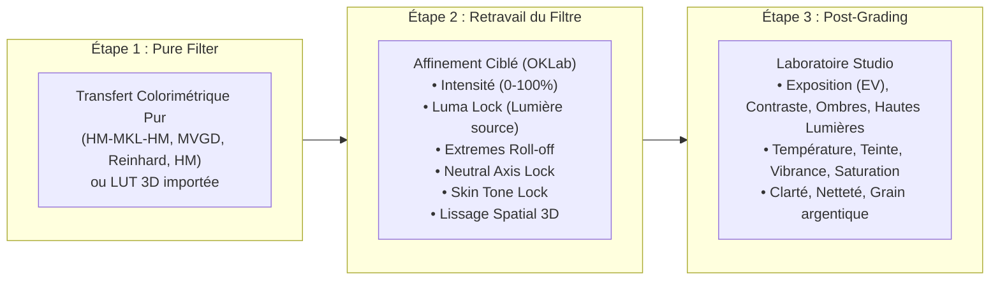
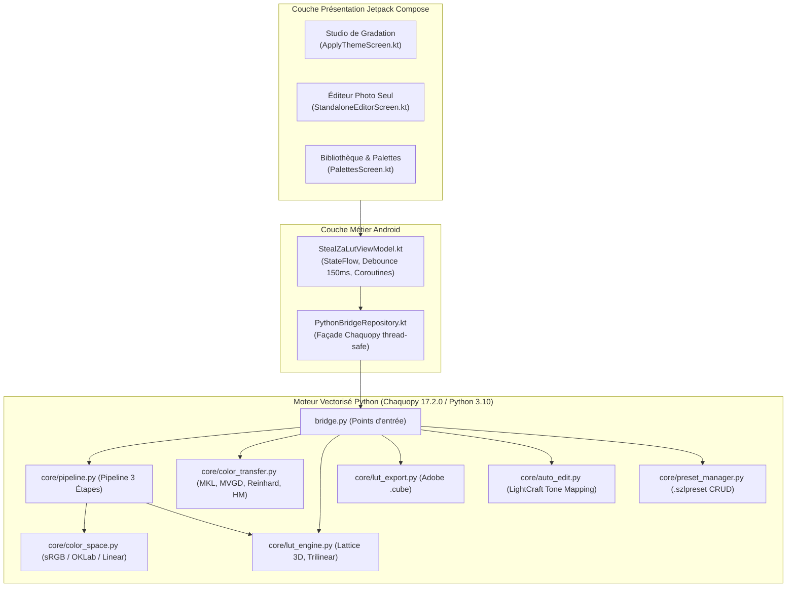

# StealZaLUT Mobile

[-3DDC84?logo=android&logoColor=white)](https://developer.android.com/)
[](https://kotlinlang.org/)
[-4285F4?logo=jetpackcompose&logoColor=white)](https://developer.android.com/jetpack/compose)
[](https://chaquo.com/chaquopy/)
[](https://scipy.org/)
[](tests/)
[](LICENSE)
[](ARCHITECTURE.md)

> **Application mobile Android 100% hors-ligne d'étalonnage cinématographique et d'édition photo studio, avec pipeline non-destructif en 3 étapes, Auto-Edit intelligent, gestionnaire de presets (`.szlpreset`) et export Adobe 3D LUT (`.cube`) de qualité professionnelle.**

---

## 1. Présentation du Projet & Parité Desktop

**StealZaLUT Mobile** est l'équivalent mobile complet de la version de référence desktop [**StealZaLUT Desktop**](https://github.com/whoismathieu/stealzalut.git). L'application transpose la puissance colorimétrique professionnelle des stations de travail de post-production cinématographique directement dans le creux de la main, sur smartphone et tablette Android.

### Parité Visuelle à 100% avec StealZaLUT Desktop
Sur Mobile comme sur Desktop, l'algorithme garantit un transfert colorimétrique dynamique et éclatant :
- **Dynamique nocturne et urbaine préservée** : Les ambiances riches (ex: ciel cyan/émeraude de nuit) et les petits détails très saturés (néons rouges et jaunes, balises d'immeubles, éclairages urbains) sont fidèlement capturés grâce à un échantillonnage haute fidélité ($512\text{ px}$ en interpolation `LANCZOS`) et à l'élimination des compressions destructrices.
- **Rendu initial pur à 100%** : Toutes les protections du filtre (verrouillage de luminance, protection de l'axe neutre, roll-off des extrêmes) sont fixées à `0.0` par défaut afin de délivrer immédiatement à l'application d'un style l'effet cinématographique pur de l'image de référence. L'utilisateur affine ensuite précisément son rendu à l'aide des curseurs de réglage.
- **Principe WYSIWYG Universel** : Ce que vous voyez sur l'écran OLED 120 Hz de votre smartphone correspond au pixel près à ce qui est encodé dans le fichier exporté ou injecté dans votre timeline vidéo desktop.

---

## 2. Fonctionnalités Majeures

### 2.1 Pipeline Non-Destructif en 3 Étapes

Le cœur du traitement repose sur un pipeline vectorisé modulaire :



1. **Étape 1 : Pure Filter**
   - Implémente les algorithmes de transfert optimal de distributions : `hm-mkl-hm`, `mkl`, `hm-mvgd-hm`, `mvgd`, `reinhard` (CIE $L^*a^*b^*$ D65) et `hm` (Histogram Matching 1D par canal).
   - Construit une table de correspondance 3D unifiée (`compute_lut` / `generate_lut_from_pair`) à partir d'échantillons conservant l'aspect ratio et les détails lumineux fins.
2. **Étape 2 : Retravail du Filtre (Calibration)**
   - **Intensité globale** : Interpolation linéaire fluide entre l'image originale et le filtre pur.
   - **Luma Lock** : Verrouillage de la luminance perçue dans l'espace perceptuel uniforme OKLab.
   - **Extremes Roll-off** : Préservation progressive des blancs spéculaires ($L > 0.85$) et des ombres profondes ($L < 0.15$) via lissage polynomial `smoothstep`.
   - **Neutral Axis Lock** : Protection des gris neutres et des tons achromatiques ($C < 0.03$) contre les dominantes parasites.
   - **Skin Tone Lock** : Masquage gaussien perceptuel ciblé sur les carnations humaines ($h \in [20^\circ, 65^\circ]$, $C \in [0.03, 0.25]$).
   - **Lissage Spatial 3D** : Convolutions gaussiennes 3D séparables garantissant des dégradés réguliers sans bandes ni postérisation.
3. **Étape 3 : Post-Grading & Effets Studio**
   - **Lumière** : Exposition calibrée en EV ($2^{EV}$ en espace linéaire), Contraste pondéré, Hautes Lumières et Ombres.
   - **Couleur** : Balance des blancs (Température Kelvin et Teinte vert-magenta), Saturation globale et Vibrance intelligente (amplification prioritaire des tons désaturés sans sursaturer les visages).
   - **Effets** : Clarté (contraste local par filtre passe-haut), Netteté (masque flou unsharp mask) et Grain photo procédural (bruit gaussien modulé selon la luminance).

---

### 2.2 Relais Studio ↔ Éditeur & Spécialisation des Rôles (Règle WYSIWYG)

Pour garantir une expérience professionnelle sans ambiguïté et un respect absolu de la règle d'or WYSIWYG :
- **Studio (Étalonnage Pur)** : Se concentre à 100% sur le transfert colorimétrique par 3D LUT (`HM_MKL_HM`, `MKL`, `MVGD`, `Reinhard`, `HM`). Les étapes 1 et 3 sont épurées de tout doublon d'édition, et l'étape 3 propose un **viewport d'aperçu compact épinglé en haut de l'écran** avec comparateur rideau interactif (`SPLIT_WIPE`), restant visible pendant le défilement de tous les curseurs de réglage sans clignotement. L'étape 2 affiche des **miniatures d'aperçu des styles** (`ThemeCard`).
- **Bouton « Retoucher dans l'éditeur » (Étape 5)** : Permet de basculer instantanément le résultat de l'étalonnage Studio vers l'éditeur autonome en exportant la 3D LUT en cache (`editorCustomLutPath`). L'éditeur s'ouvre avec la photo source, la LUT préchargée, tous les curseurs à zéro et un affichage instantané sans délai de recalcul (parité WYSIWYG prouvée avec $\Delta \le 1$ niveau 8 bits).
- **Auto-Edit « LightCraft » dans l'Éditeur** : L'analyse optique logarithmique Rec. 2020 calibrée sur carte 18% est directement intégrée dans l'éditeur autonome, ajustant dynamiquement l'exposition, le contraste, les ombres, les hautes lumières et la vibrance.

---

### 2.3 Mode "Éditeur Photo Seul" (Standalone Photo Studio) & Ergonomie Mobile

Un espace de création dédié accessible directement depuis la barre de navigation principale :
- **Retouche autonome** : Modifiez n'importe quelle photo de votre galerie sans nécessiter d'image de référence B.
- **Importation de LUTs externes** : Chargez n'importe quel fichier `.cube` tiers et appliquez-lui le pipeline complet (Retravail Étape 2 + Grading Étape 3).
- **Zone d'aperçu proportionnelle adaptative** : Calculée dynamiquement à ~40% de la hauteur utile de l'écran (200 à 360 dp) pour libérer 60% d'espace aux onglets et curseurs de réglage.
- **Bouton unique « Réinitialiser tout » avec confirmation & Annulation (Undo)** : Un clic réinitialise l'ensemble des réglages et affiche un Snackbar d'annulation (`undoEditor()`) permettant de restaurer instantanément l'état précédent.
- **Barre d'outils accessible** : Conçue pour respecter les zones d'insets de navigation gestuelle Android (`navigationBarsPadding()`).
- **Navigation par onglets thématiques** :
  - *Presets & LUTs* : Gestion de votre bibliothèque de looks et importation de fichiers `.cube`.
  - *Calibrage* : Contrôle des 6 paramètres avancés de l'Étape 2.
  - *Lumière* : Exposition, Contraste, Hautes Lumières, Ombres.
  - *Couleur* : Température, Teinte, Vibrance, Saturation.
  - *Effets* : Clarté, Netteté, Grain argentique.
- **Expérience tactile haut de gamme** :
  - **Comparaison tactile robuste** : Appui maintenu (`HOLD_TO_COMPARE`) avec détection stationnaire de 400 ms sur toute la surface et relâchement garanti sans blocage.
  - **Pinch-to-zoom & Panoramique synchronisés** : Inspectez les détails jusqu'à $4\times$, réinitialisable par double-tap ($1\times$).
  - **Double-tap Reset** : Double-cliquez sur n'importe quel curseur pour le ramener à sa valeur neutre.
  - **Undo / Redo illimité** : Annulez et rétablissez librement vos manipulations d'édition depuis la barre supérieure.
  - **Histogramme RVB temps réel** : Analyse dynamique des canaux Rouge, Vert, Bleu superposable à l'image.

---

### 2.4 Système de Presets d'Édition (`.szlpreset` v2)

- **Format ouvert et versionné (Schéma v2)** : Fichiers JSON légers (`.szlpreset`) enregistrant la totalité de vos réglages (Étape 2, Étape 3, métadonnées, chemin de la LUT associée et miniature encodée) avec migration automatique et rétro-compatibilité totale avec les anciens formats non versionnés.
- **Opérations étendues** :
  - Sauvegarder, appliquer, supprimer, dupliquer et renommer des presets.
  - Importer et exporter des fichiers `.szlpreset` autonomes pour le partage entre appareils.

---

### 2.5 Qualité d'Image HD & Exportation Conforme Adobe 3D LUT (`.cube`)

- **Conformité stricte Adobe** : Ordre de parcours $B \to G \to R$ (le canal Rouge varie le plus rapidement dans le fichier texte).
- **Assainissement des données** : Clamping rigoureux dans $[0.0, 1.0]$, remplacement des valeurs `NaN` et `Inf`, en-têtes standardisés reconnus par DaVinci Resolve, Premiere Pro, Final Cut Pro, Photoshop, CapCut et les moniteurs de tournage SmallHD / Atomos.
- **Baking complet des 3 Étapes** : Tous les réglages colorimétriques de l'Étape 1, de l'Étape 2 et de l'Étape 3 sont fusionnés dans la table `.cube` exportée (avec contournement automatique des effets 2D spatiaux non-linéaires).
- **Tiling Mémoire Anti-OOM (Images > 12 MP)** : Traitement vectorisé par blocs/tranches de rangées (plafond 2 Mpx par tranche) garantissant une empreinte RAM minimale ($< 100\text{ Mo}$) et zéro artefact de raccord aux bords de tuiles, même sur des photographies de 50 à 100 Mpx.
- **Préservation Intégrale des Métadonnées EXIF** : Conservation automatique de l'orientation (normalisée à 1 pour éviter toute double rotation), de l'appareil, de l'objectif, de l'exposition et des données de capture.

---

### 2.6 Design System Multi-Thèmes & Accessibilité (WCAG AA)

- **4 Thèmes interchangeables** :
  - *Ambre Noir* : Esthétique studio cinématographique sombre d'origine.
  - *Cyan Studio* : Ambiance chambre noire professionnelle cyan profond.
  - *OLED Noir Absolu* : Fond 100% noir pour économie de batterie sur écrans AMOLED.
  - *Lumière du Jour* : Thème clair à fort contraste pour utilisation en extérieur sous le soleil.
- **Zéro Flash au Démarrage & Zéro Artefact** : Démarrage synchronisé avec `windowBackground`, bascule à chaud sans perte d'état et tests de contraste WCAG AA validés par test JVM.

---

## 3. Architecture Technique

StealZaLUT Mobile s'appuie sur une Clean Architecture réactive liant l'UI déclarative Jetpack Compose au moteur vectorisé NumPy/SciPy via Chaquopy :



---

## 4. Tests et Instructions de Build

### Prérequis
- **Android Studio** : Ladybug ou supérieur
- **JDK** : Version 17 ou supérieure
- **Python** : 3.10 ou supérieur (avec `numpy`, `scipy`, `pillow`, `pytest`)

### Exécuter les tests unitaires Python (Core mathématique)
**PowerShell (Windows) :**
```powershell
$env:PYTHONPATH="app/src/main/python"
pytest tests/ -q
```
**Bash (Linux / macOS) :**
```bash
PYTHONPATH=app/src/main/python pytest tests/ -q
```
> **Résultat attendu :** 99 tests passés avec succès (validation des conversions OKLab, transport optimal MKL/MVGD, génération de LUTs, baking 3 étapes, format Adobe `.cube`, tiling mémoire anti-OOM, préservation EXIF et persistance presets v2).

### Exécuter les tests unitaires Android (Kotlin JVM)
**PowerShell (Windows) :**
```powershell
.\gradlew.bat testDebugUnitTest
```
**Bash (Linux / macOS) :**
```bash
./gradlew testDebugUnitTest
```
> **Résultat attendu :** 26 tests unitaires JVM passés avec succès (garde du Design System, contrastes WCAG AA, relais Studio ↔ Éditeur, persistance JSON et exports SAF). L'application comprend également 2 tests instrumentés (`androidTest`) pour un total de 28 tests Kotlin.

### Lancer l'analyse statique Android Lint
**PowerShell (Windows) :**
```powershell
.\gradlew.bat lintDebug
```
**Bash (Linux / macOS) :**
```bash
./gradlew lintDebug
```

### Compiler le projet Android
**PowerShell (Windows) :**
```powershell
.\gradlew.bat compileDebugKotlin
```
**Bash (Linux / macOS) :**
```bash
./gradlew compileDebugKotlin
```

---

## 5. Licence
Projet sous licence [MIT](LICENSE).
Inspiré par le projet original [StealZaLUT Desktop](https://github.com/whoismathieu/stealzalut.git) par Mathieu.

*Dernière mise à jour : 9 novembre 2026*
