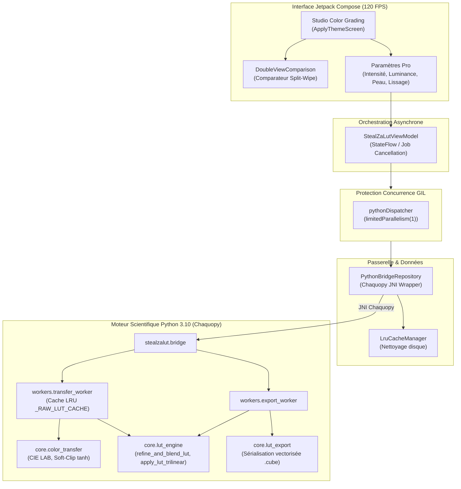

# StealZaLUT Mobile

[-3DDC84?logo=android&logoColor=white)](https://developer.android.com/)
[](https://kotlinlang.org/)
[-4285F4?logo=jetpackcompose&logoColor=white)](https://developer.android.com/jetpack/compose)
[](https://chaquo.com/chaquopy/)
[](https://scipy.org/)
[](LICENSE)
[](CODING_STANDARDS.md)

> **Application Android 100% hors-ligne d'étalonnage cinématographique haute fidélité, avec moteur colorimétrique professionnel unifié (WYSIWYG) et export Adobe 3D LUT (`.cube`).**

---

## 1. Présentation du Projet

**StealZaLUT Mobile** est une solution professionnelle d'étalonnage photographique et cinématographique embarquée sur Android. Elle permet aux créateurs de contenu, photographes et coloristes de capturer l'atmosphère et l'harmonie chromatique d'une œuvre de référence (film culte, photographie d'art, rendu argentique) pour l'appliquer instantanément à leurs propres clichés ou l'exporter au standard de l'industrie : le fichier **Adobe 3D LUT (`.cube`)**.

### Le Principe WYSIWYG (*What You See Is What You Get*)
Historiquement, de nombreuses applications mobiles appliquent un curseur d'opacité en superposant visuellement deux images dans l'interface, créant un décalage flagrant entre ce que l'utilisateur voit à l'écran et la table de correspondance `.cube` exportée.

**Dans StealZaLUT Mobile, l'aperçu et le fichier `.cube` sont strictement unifiés :**
- Tous les paramètres de post-traitement (**Intensité / Force**, **Préservation de la Luminance**, **Protection des Tons Chairs**, **Lissage spatial 3D**, **Verrouillage de l'axe neutre**, **Soft-Clipping**) sont **directement fusionnés dans la grille 3D de la LUT (`refine_and_blend_lut`)**.
- L'image d'aperçu affichée à l'écran est produite **en faisant passer l'image source réduite à travers cette exacte grille 3D via interpolation trilinéaire vectorisée (`apply_lut_trilinear`)**.
- Chaque déplacement de curseur met à jour la LUT 3D et affiche immédiatement son rendu exact sur la photo : **ce qui est visible à l'écran est pixel pour pixel ce qui est écrit dans le fichier `.cube`**.

Les fichiers `.cube` générés sont compatibles sans ajustement avec :
* **Logiciels de montage et d'étalonnage (Desktop)** : DaVinci Resolve, Adobe Premiere Pro, Final Cut Pro, Adobe Lightroom, Photoshop, Avid Media Composer.
* **Applications vidéo mobiles** : CapCut, VN Video Editor, LumaFusion, Alight Motion.
* **Moniteurs de tournage & Caméras broadcast** : Atomos Ninja/Shogun, SmallHD, Blackmagic Video Assist, Sony FX3/FX6/FX9, RED, ARRI.

Le traitement s'exécute **intégralement en local sur l'appareil (100% Offline)**, sans aucun recours au cloud, sans création de compte et dans le respect absolu de la vie privée.

---

## 2. Fonctionnalités Clés et Innovations Colorimétriques

### 2.1 Pipeline Unifié Prévisualisation = `.cube` (WYSIWYG)
- Fin définitive des divergences entre sliders UI et exports `.cube`.
- L'image de prévisualisation, l'image haute résolution exportée et le fichier `.cube` partagent exactement le même graphe de transformation 3D.
- Cache LRU intelligent en mémoire vive Python (`transfer_worker.py`) réutilisant la `raw_lut` précalculée : le recalcul de la LUT raffinée prend **moins de $3\text{ ms}$** sur une grille $33 \times 33 \times 33$.

### 2.2 Algorithmes Scientifiques de Qualité Studio
1. **Préservation de la Luminance CIE LAB (`preserve_luminance: float = 0.75`)** :
   - Découplage de la luminance $L^*$ et de la chrominance $a^*b^*$ dans l'espace perceptuel uniforme CIE L\*a\*b\*.
   - Transfert à 100% des composantes de couleur tout en conservant la structure d'exposition originale de la photo source :
     $$L_{\text{final}} = \lambda \cdot L_{\text{src}} + (1.0 - \lambda) \cdot L_{\text{trans}}$$
   - Évite les images bouchées ou brûlées lorsque la référence a une exposition très différente de la source.
   - Limitation adaptative du ratio des écarts-types $\sigma_{\text{ref}} / \sigma_{\text{src}} \in [0.5, 2.0]$ pour prévenir toute casse de contraste.
2. **Protection Intelligente des Tons Chairs (`skin_protection: float = 0.5`)** :
   - Modélisation gaussienne 3D continue dans l'espace chromatique YCbCr (ITU-R BT.601) centrée sur le cluster universel des teintes de peau humaine ($C_b \approx 0.40, C_r \approx 0.60, R > G > B$).
   - Mélange localement la LUT vers la grille identité à hauteur de $\text{skin\_protection} \cdot \text{skin\_mask}$, préservant le naturel des visages même sous un étalonnage agressif (ex: thème glacial, vert matrice ou coucher de soleil sur-saturé).
3. **Verrouillage de l'Axe Neutre & Noirs/Blancs Purs (`neutral_lock: float = 0.8`)** :
   - Calcule la distance de chaque cellule par rapport au noir pur $(0,0,0)$ et au blanc pur $(1,1,1)$.
   - Force progressivement la chrominance à revenir vers l'axe neutre aux extrémités de la diagonale de luminance, évitant les dominantes verdâtres ou violacées dans les ombres profondes et les hautes lumières cramées.
4. **Lissage Spatial 3D Séparable (`smooth_sigma: float = 0.6`)** :
   - Filtre gaussien 3D séparable exécuté en pur NumPy avec réplication des bords (`np.pad(mode='edge')`).
   - Élimine tout artefact de gradient (banding, postérisation) et garantit la stricte monotonie des courbes sans dépendre de bibliothèques externes.
5. **Écrêtage Doux des Extrêmes / Soft-Knee Roll-Off (`soft_clip: bool = True`)** :
   - Remplace les `clip(0, 1)` brutaux par une compression douce en tangente hyperbolique ($\tanh$) sur les $5\%$ les plus sombres ($[0.0, 0.05]$) et les $5\%$ les plus clairs ($[0.95, 1.0]$), préservant les détails subtils dans les nuages et les feuillages sombres.

### 2.3 Comparateur Avant / Après Haute Précision
- **Mode Côte-à-Côte** avec zoom tactile et déplacement panoramique synchronisés en temps réel.
- **Mode Rideau Interactif (Split-Wipe)** permettant de balayer l'image d'un doigt pour révéler la colorimétrie différentielle.

### 2.4 Résolutions de Grille LUT
- $17 \times 17 \times 17$ ($4\,913$ nœuds) : Idéal pour les prévisualisations mobiles ultra-légères.
- $33 \times 33 \times 33$ ($35\,937$ nœuds) : **Standard Broadcast & Cinéma** (recommandé).
- $65 \times 65 \times 65$ ($274\,625$ nœuds) : Très haute précision pour les dégradés complexes.

---

## 3. Architecture Technique

Le projet repose sur une Clean Architecture réactive liant l'UI déclarative Jetpack Compose au moteur scientifique vectorisé Python 3.10.



---

## 4. Pipeline Mathématique et Spécification WYSIWYG

```
       [Source Image]           [Reference Image]
             │                          │
             ▼                          ▼
      ┌──────────────┐          ┌──────────────┐
      │  src_proxy   │          │  ref_proxy   │
      └──────────────┘          └──────────────┘
             │                          │
             └───────────┬──────────────┘
                         ▼
        ┌───────────────────────────────────┐
        │       compute_lut()               │  Transfert sur lattice identité
        │  (HM-MKL-HM / Reinhard + LAB)    │  avec preserve_luminance & soft-clip
        └───────────────────────────────────┘
                         │
                         ▼
                 [ Raw 3D LUT ]  <── Mis en cache mémoire vive (<5ms recalcul)
                         │
                         ▼
        ┌───────────────────────────────────┐
        │     refine_and_blend_lut()        │
        │  1. Identity LUT                  │
        │  2. Skin Tone Protection (YCbCr)  │
        │  3. Neutral Axis Lock (0 & 1)     │
        │  4. 3D Gaussian Smoothing         │
        │  5. Direct Intensity Blending     │
        └───────────────────────────────────┘
                         │
                         ▼
                [ Final 3D LUT ]
                         │
        ┌────────────────┴──────────────────┐
        ▼                                   ▼
┌───────────────────────────────┐   ┌───────────────────────────────┐
│     apply_lut_trilinear()     │   │         export_cube()         │
│   Interpolation sur preview   │   │   Sérialisation Adobe .cube   │
│   Rendu écran WYSIWYG exact   │   │   Baking des paramètres pro   │
└───────────────────────────────┘   └───────────────────────────────┘
```

### 1. Interpolation Barycentrique Trilinéaire Vectorisée
Pour chaque pixel d'une image source normalisée $(r, g, b) \in [0, 1]^3$, ses coordonnées dans une grille de taille $N$ sont :
$$x = r \cdot (N - 1), \quad y = g \cdot (N - 1), \quad z = b \cdot (N - 1)$$
Les indices de cellule inférieure sont $x_0 = \lfloor x \rfloor, y_0 = \lfloor y \rfloor, z_0 = \lfloor z \rfloor$, et les résidus fractionnaires :
$$\Delta x = x - x_0, \quad \Delta y = y - y_0, \quad \Delta z = z - z_0$$
La valeur de couleur interpolée est la combinaison convexe des 8 sommets du cube environnant :
$$\mathbf{C}_{\text{interp}} = \sum_{i=0}^1 \sum_{j=0}^1 \sum_{k=0}^1 (1 - \Delta z + 2 k \Delta z - k)(1 - \Delta y + 2 j \Delta y - j)(1 - \Delta x + 2 i \Delta x - i) \cdot \mathbf{LUT}[z_0+k, y_0+j, x_0+i]$$
Implémenté en pure vectorisation NumPy, ce calcul traite une image $1024 \times 1024$ sans aucune boucle Python.

### 2. Formule de Protection des Peaux
Le masque 3D de teinte de peau dans l'espace ITU-R BT.601 YCbCr est donné par la distance de Mahalanobis approchée :
$$d^2 = \left(\frac{C_b - 0.40}{0.08}\right)^2 + \left(\frac{C_r - 0.60}{0.08}\right)^2$$
$$\text{skin\_mask} = \exp\left(-\frac{d^2}{2}\right) \cdot \text{clamp}\left(\frac{R - G}{0.05}\right) \cdot \text{clamp}\left(\frac{G - B}{0.05}\right) \cdot \text{window}(Y)$$
La LUT est ensuite mélangée localement :
$$\mathbf{LUT}_{\text{peau}} = (1 - w_s) \cdot \mathbf{LUT} + w_s \cdot \mathbf{LUT}_{\text{identite}}, \quad w_s = \text{skin\_protection} \cdot \text{skin\_mask}$$

---

## 5. API du Pont Python (`stealzalut.bridge`)

Toutes les fonctions sont appelables depuis Chaquopy ou directement en Python :

### `process_preview`
```python
from stealzalut.bridge import process_preview

result = process_preview(
    src_path="/path/to/source.jpg",
    ref_path="/path/to/reference.jpg",
    method="hm-mkl-hm",
    intensity=0.85,
    output_preview_path="/path/to/preview.jpg",
    max_preview_dim=1024,
    preserve_luminance=0.75,
    skin_protection=0.50,
    smooth_sigma=0.60,
    neutral_lock=0.80,
    lut_size=33
)
# Retour: {"status": "success", "preview_path": "...", "execution_time_ms": 112.4}
```

### `export_cube_file`
```python
from stealzalut.bridge import export_cube_file

result = export_cube_file(
    src_path="/path/to/source.jpg",
    ref_path="/path/to/reference.jpg",
    output_cube_path="/path/to/output.cube",
    lut_size=33,
    method="hm-mkl-hm",
    intensity=0.85,
    preserve_luminance=0.75,
    skin_protection=0.50,
    smooth_sigma=0.60,
    neutral_lock=0.80
)
# Retour: {"status": "success", "cube_path": "...", "lut_size": 33, "execution_time_ms": 8.2}
```

---

## 6. Tests & Validation

La suite de tests unitaires et d'intégration valide rigoureusement l'ensemble des exigences colorimétriques, le respect des types, la performance et la parité WYSIWYG :

```bash
# Exécution de la suite de tests unitaires Python (48 tests complets)
python -m pytest tests/
```

### Couverture des Tests :
- `tests/test_lut_engine.py` : Invariant `intensity = 0.0` $\implies$ LUT identité ($\Delta_{\max} < 10^{-6}$), point médian `intensity = 0.5`, protection des peaux, verrouillage neutre, lissage 3D, interpolation trilinéaire.
- `tests/test_lut_export.py` : Exportation `.cube`, format d'en-tête standard, intégration de l'intensité dans le fichier `.cube`, correspondance pixel pour pixel preview $\leftrightarrow$ `.cube`.
- `tests/test_color_transfer.py` : Préservation de luminance CIE LAB (`preserve_luminance = 1.0` conserve $L$ tout en altérant $A, B$), écrêtage doux tanh sur les ombres et hautes lumières.
- `tests/test_bridge.py` & `tests/test_colorset_worker.py` : Robustesse, gestion d'erreurs et codes d'erreur explicites.

---

## 7. Normes de Développement

Consultez le fichier **[CODING_STANDARDS.md](CODING_STANDARDS.md)** pour le détail des conventions PEP 8, Kotlin, conventions NumPy (`float32`, intervalles $[0.0, 1.0]$ vs $[0, 255]$) et politiques de cache.

---

## 8. Licences & Remerciements

* **Chaquopy** — Runtime Python pour Android.
* **Color-Matcher** — Bibliothèque de transport optimal et alignement de distributions.
* **Jetpack Compose** — Boîte à outils UI déclarative moderne Android.
* **NumPy & SciPy** — Calcul numérique et scientifique de haute précision.

Projet distribué sous licence libre **MIT**. Consultez le fichier `LICENSE` pour plus d'informations.
